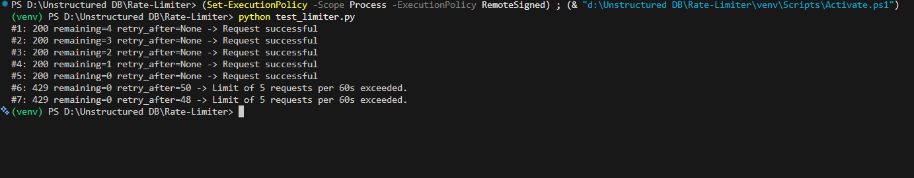
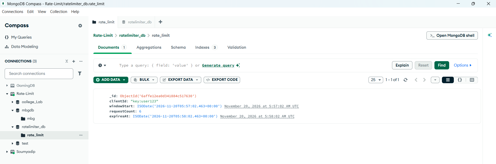
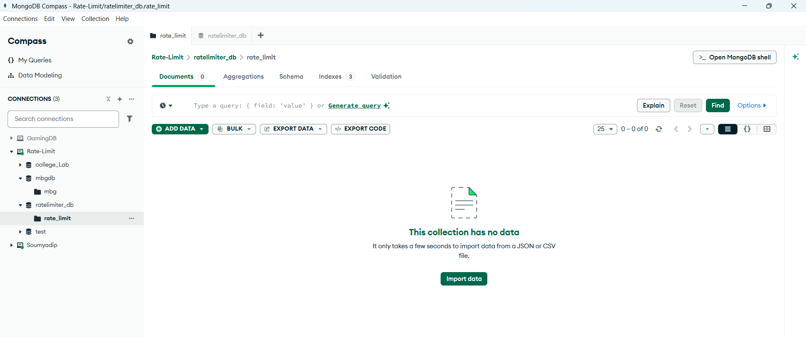
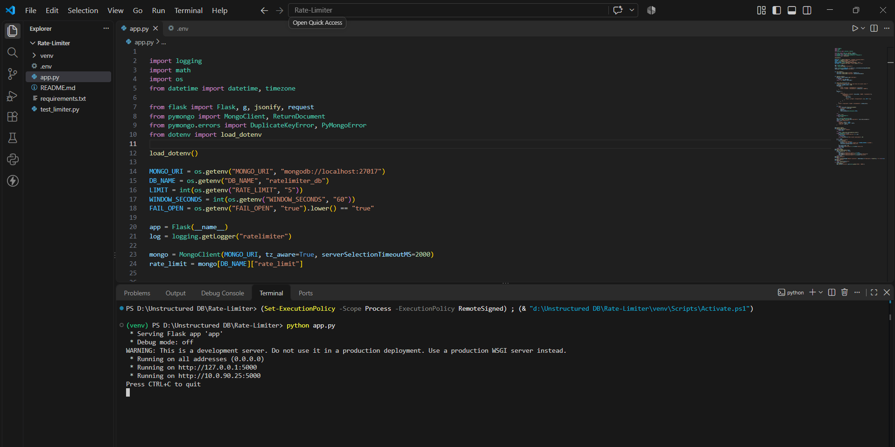

# Rate Limiter (Flask + MongoDB)

A fixed-window API rate limiter backed by MongoDB. Default: **5 requests per 60 seconds per client**.
Clients are identified by the `X-API-Key` header, falling back to IP address.

## Project structure
```
rate-limiter-mongodb/
├── rate_limiter/
│   ├── __init__.py     # Flask app factory
│   ├── config.py       # settings from environment / .env
│   ├── db.py           # MongoDB connection + indexes
│   ├── limiter.py      # rate limiting logic and request hooks
│   └── routes.py       # API endpoints
├── scripts/
│   └── test_limiter.py # sends 7 requests to demo the limit
├── docs/               # demo screenshots
├── run.py              # entry point
├── requirements.txt
├── .env.example
└── .gitignore
```

## Data model
One document per client in the `rate_limit` collection:

| Field | Purpose |
|---|---|
| `clientId` | API key or IP address (unique index) |
| `requestCount` | Requests made in the current window |
| `windowStart` | When the current window started |
| `expiresAt` | When the document expires (TTL index) |

## How it works
Every request runs a single atomic `find_one_and_update` (upsert + update pipeline) that either
starts a new window or increments the counter, so concurrent requests cannot race.
If the counter exceeds the limit the API responds `429 Too Many Requests` with a `Retry-After` header.
A TTL index on `expiresAt` removes stale documents automatically.

## Demo

**Requests 1-5 are allowed, requests 6-7 are blocked with `429`:**



**The stored document in MongoDB Compass** (`requestCount` is capped at limit + 1):



**The document is removed automatically by the TTL index after the window expires:**



**The server running with settings loaded from `.env`:**



## Setup
Requires Python 3.10+ and MongoDB 4.2+ (uses `$$NOW` and pipeline updates).

```bash
python -m venv venv
venv\Scripts\activate          # Mac/Linux: source venv/bin/activate
pip install -r requirements.txt
copy .env.example .env         # Mac/Linux: cp .env.example .env
python run.py
```

In a second terminal:

```bash
python scripts/test_limiter.py
```

Requests 1-5 return `200`; requests 6-7 return `429`.

## Configuration (`.env`)
| Variable | Default | Meaning |
|---|---|---|
| `MONGO_URI` | `mongodb://localhost:27017` | MongoDB connection string |
| `DB_NAME` | `ratelimiter_db` | Database name |
| `RATE_LIMIT` | `5` | Max requests per window |
| `WINDOW_SECONDS` | `60` | Window length |
| `FAIL_OPEN` | `true` | Allow requests if MongoDB is unreachable |
| `PORT` | `5000` | Server port |

## Endpoints
- `GET /api/data` - rate limited
- `GET /health` - not rate limited

Response headers: `X-RateLimit-Limit`, `X-RateLimit-Remaining`, `X-RateLimit-Reset`, and `Retry-After` on 429.
